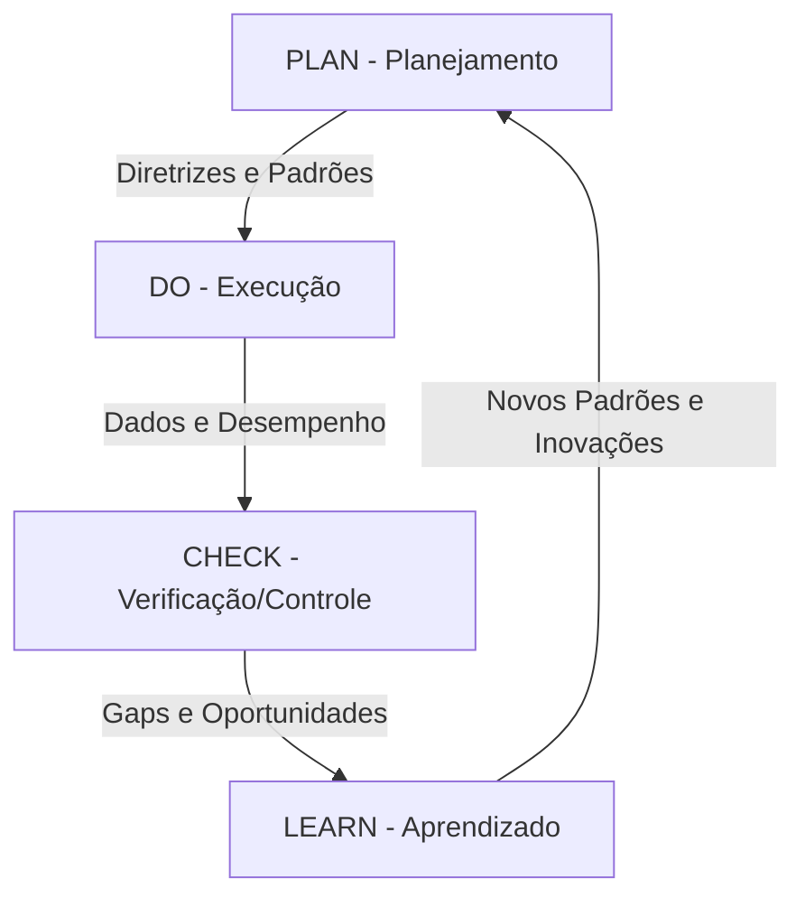

# MODELO DE EXCELÊNCIA DA GESTÃO® (MEG)
## GUIA DE REFERÊNCIA DA GESTÃO PARA EXCELÊNCIA — 21ª EDIÇÃO
### Fundação Nacional da Qualidade — FNQ

---

**Ficha Catalográfica e Expediente Oficial**
* **Título Original:** Guia de Referência da Gestão para Excelência — 21ª Edição
* **Instituição:** Fundação Nacional da Qualidade (FNQ) — São Paulo/SP, Brasil
* **ISBN:** 978-85-8139-055-0
* **Extensão:** 100 páginas (Edição Física Original)
* **Objetivo Oficial:** Ao utilizar os Fundamentos da Gestão para Excelência como referência, a organização pode realizar uma autoavaliação e obter um diagnóstico consistente da maturidade de sua gestão.

---

## SUMÁRIO GERAL

1. [Prefácio](#prefácio)
2. [Capítulo 1 — Introdução](#capítulo-1--introdução)
   - 1.1 [Sobre a Fundação Nacional da Qualidade (FNQ)](#11-sobre-a-fundação-nacional-da-qualidade-fnq)
   - 1.2 [O Modelo de Excelência da Gestão® (MEG)](#12-o-modelo-de-excelência-da-gestão-meg)
   - 1.3 [O Diagrama do MEG (O Tangram Sistêmico)](#13-o-diagrama-do-meg-o-tangram-sistêmico)
   - 1.4 [Os Oito Fundamentos da Gestão para Excelência](#14-os-oito-fundamentos-da-gestão-para-excelência)
   - 1.5 [Processos e Resultados](#15-processos-e-resultados)
   - 1.6 [Diagrama do Ciclo da Gestão](#16-diagrama-do-ciclo-da-gestão)
   - 1.7 [O Ciclo PDCL (Plan, Do, Check, Learn)](#17-o-ciclo-pdcl-plan-do-check-learn)
   - 1.8 [Como Interpretar os Fundamentos](#18-como-interpretar-os-fundamentos)
3. [Capítulo 2 — Fundamentos da Gestão para Excelência (Detalhamento Integral)](#capítulo-2--fundamentos-da-gestão-para-excelência)
   - 2.1 [Fundamento 1: Pensamento Sistêmico](#21-fundamento-1-pensamento-sistêmico)
   - 2.2 [Fundamento 2: Compromisso com as Partes Interessadas](#22-fundamento-2-compromisso-com-as-partes-interessadas)
   - 2.3 [Fundamento 3: Aprendizado Organizacional e Inovação](#23-fundamento-3-aprendizado-organizacional-e-inovação)
   - 2.4 [Fundamento 4: Adaptabilidade](#24-fundamento-4-adaptabilidade)
   - 2.5 [Fundamento 5: Liderança Transformadora](#25-fundamento-5-liderança-transformadora)
   - 2.6 [Fundamento 6: Desenvolvimento Sustentável](#26-fundamento-6-desenvolvimento-sustentável)
   - 2.7 [Fundamento 7: Orientação por Processos](#27-fundamento-7-orientação-por-processos)
   - 2.8 [Fundamento 8: Geração de Valor](#28-fundamento-8-geração-de-valor)
4. [Capítulo 3 — Glossários](#capítulo-3--glossários)
   - 3.1 [Glossário de Termos Fundamentais](#31-glossário-de-termos-fundamentais)
   - 3.2 [Glossário de Ferramentas e Metodologias](#32-glossário-de-ferramentas-e-metodologias)
5. [Capítulo 4 — Referências e Índice Remissivo](#capítulo-4--referências-e-índice-remissivo)
   - 4.1 [Principais Referências Bibliográficas](#41-principais-referências-bibliográficas)
   - 4.2 [Índice Remissivo](#42-índice-remissivo)

---

# PREFÁCIO

A Fundação Nacional da Qualidade (FNQ) tem o orgulho de apresentar a 21ª edição do **Guia de Referência da Gestão para Excelência**, consolidando um marco histórico na evolução dos modelos de gestão no Brasil e no mundo.

O Modelo de Excelência da Gestão® (MEG) foi concebido para ser uma representação dinâmica e viva de como organizações líderes mundiais operam, aprendem, adaptam-se e geram valor sustentável a todas as suas partes interessadas. Nesta 21ª edição, o modelo aprofunda sua visão holística, abandonando a antiga divisão mecanicista de critérios isolados para abraçar um ecossistema integrado simbolizado pelo **Tangram** — o milenar quebra-cabeça chinês que desafia a organização a remontar suas peças para encontrar sua própria identidade competitiva.

O MEG não é um manual de regras prescritivas. Ele não impõe estruturas hierárquicas rígidas nem engessa a criatividade empresarial. Pelo contrário: ele estimula perguntas profundas, provoca reflexões estratégicas e orienta a jornada de maturidade da gestão através do ciclo **PDCL (Plan - Do - Check - Learn)**.

Dedicamos este trabalho aos milhares de voluntários, especialistas dos Núcleos Temáticos, examinadores do Prêmio Nacional da Qualidade (PNQ) e líderes empresariais e públicos que acreditam que a excelência da gestão é o motor fundamental para transformar organizações e construir um país mais ético, produtivo, justo e sustentável.

*Boa leitura!*

**Marcos Bardagi**  
*Gerente de Portfólio, Operações e Conhecimento da FNQ*

---

# CAPÍTULO 1 — INTRODUÇÃO

## 1.1 Sobre a Fundação Nacional da Qualidade (FNQ)

Criada em 1991 como Fundação para o Prêmio Nacional da Qualidade (FPNQ) e posteriormente rebatizada como Fundação Nacional da Qualidade (FNQ), a instituição consolidou-se como o principal polo irradiador da cultura da excelência em gestão no Brasil.

### Missão Institucional
> *"Estimular e apoiar as organizações para o desenvolvimento e a evolução de sua gestão, por meio da disseminação dos Fundamentos e Critérios de Excelência, para que se tornem sustentáveis, cooperativas e gerem valor para a sociedade."*

### Evolução Histórica dos Direcionamentos da FNQ:
- **1991 a 1996:** Foco na **Gestão pela Qualidade Total (TQM)**, inspirada no modelo norte-americano do *Malcolm Baldrige National Quality Award (MBNQA)*.
- **1997 a 2000:** Alinhamento com modelos globais de *Business Excellence*.
- **2001 a 2002:** Criação de uma identidade genuinamente brasileira com foco em **Controle & Aprendizado de Processos Gerenciais**.
- **2003 a 2012:** Incorporação profunda da **Sustentabilidade**, Governança Corporativa e integração de processos gerenciais, inspirando-se também no modelo europeu da *EFQM (European Foundation for Quality Management)*.
- **2013 em diante:** Gestão voltada à **Flexibilidade, Inovação, Redes e Adaptabilidade**.
- **2016 (21ª Edição):** Consolidação do **MEG Sistêmico**, estruturado em **8 Fundamentos da Gestão para Excelência**, dinamicamente conectados através da representação do Tangram e operados pelo ciclo **PDCL**.
- **2018 em diante:** Direcionamento estratégico para a **Gestão para a Transformação**, preparando as empresas para o ambiente VUCA/BANI e para a Transformação Digital.

---

## 1.2 O Modelo de Excelência da Gestão® (MEG)

O MEG é um modelo integrador, sistêmico e não prescritivo:
- **Modelo Integrador:** Reúne e harmoniza as melhores práticas mundiais de governança, estratégia, foco no cliente, gestão de pessoas, responsabilidade socioambiental, gestão da informação e processos operacionais sob um único teto coerente.
- **Não Prescritivo:** Não dita "como fazer", não prescreve softwares ou organogramas específicos. Define "o que é necessário abordar" para alcançar a classe mundial, respeitando a cultura, o setor e o porte de cada empresa.
- **Evolutivo e Adaptável:** Permite que a organização avalie seu nível de maturidade e trace sua rota personalizada de evolução contínua.

---

## 1.3 O Diagrama do MEG (O Tangram Sistêmico)

Na 21ª edição, o MEG adota a representação gráfica baseada nas sete peças geométricas do **Tangram** envoltas por um círculo dinâmico de aprendizado:

```
+-----------------------------------------------------------------------+
|                 APRENDIZADO ORGANIZACIONAL E INOVAÇÃO                 |
|                                                                       |
|         +-----------------------+-----------------------+             |
|         |                       |                       |             |
|         |     ADAPTABILIDADE    |   PENSAMENTO SISTÊMICO|             |
|         |                       |                       |             |
|         +-----------------------+-----------------------+             |
|         | DESENVOLVIMENTO       | LIDERANÇA             |             |
|         | SUSTENTÁVEL           | TRANSFORMADORA        |             |
|         +-----------------------+-----------------------+             |
|         | COMPROMISSO COM AS    | ORIENTAÇÃO POR        |             |
|         | PARTES INTERESSADAS   | PROCESSOS             |             |
|         +-----------------------+-----------------------+             |
|                                                                       |
|                          GERAÇÃO DE VALOR                             |
|                                                                       |
|                 APRENDIZADO ORGANIZACIONAL E INOVAÇÃO                 |
+-----------------------------------------------------------------------+
```

### Leitura Conceitual do Diagrama:
> *"Considerando o **Desenvolvimento Sustentável** e o **Compromisso com as Partes Interessadas**, a **Liderança Transformadora**, a partir do **Pensamento Sistêmico**, define como as estratégias e os planos devem ser implementados e materializados por meio da **Orientação por Processos** e com **Adaptabilidade**, resultando em **Geração de Valor** para a própria organização e as partes interessadas. A partir disso, a organização busca evoluir por meio do **Aprendizado Organizacional e Inovação**, que permeiam todo o sistema, promovendo a excelência contínua."*

---

## 1.4 Os Oito Fundamentos da Gestão para Excelência

Os Fundamentos expressam os conceitos reconhecidos internacionalmente que se traduzem em práticas de alto desempenho:

| Nº | Fundamento | Definição Oficial (FNQ) |
|---|---|---|
| **1** | **Pensamento Sistêmico** | Compreensão e tratamento das relações de interdependência e seus efeitos entre os diversos componentes da organização, bem como entre eles e o ambiente externo com o qual interagem. |
| **2** | **Compromisso com as Partes Interessadas** | Estabelecimento de relações de confiança e parcerias com as partes interessadas (clientes, força de trabalho, fornecedores, acionistas, sociedade), buscando o atendimento de suas necessidades e expectativas de forma equilibrada. |
| **3** | **Aprendizado Organizacional e Inovação** | Busca permanente de novos patamares de competência por meio da percepção, reflexão, avaliação e compartilhamento de conhecimentos e experiências, promovendo um ambiente propício à criatividade e inovação. |
| **4** | **Adaptabilidade** | Flexibilidade e rapidez de resposta às mudanças do ambiente, mantendo o foco nas demandas dos clientes e antecipando-se às transformações de cenários e riscos. |
| **5** | **Liderança Transformadora** | Atuação dos líderes de forma inspiradora, exemplar e com constância de propósito, mobilizando as pessoas em torno de valores, princípios, estratégias e metas organizacionais. |
| **6** | **Desenvolvimento Sustentável** | Compromisso com a perenidade da organização nos aspectos econômico, social e ambiental, considerando os impactos de suas decisões e atividades na sociedade e no meio ambiente. |
| **7** | **Orientação por Processos** | Reconhecimento de que a organização é uma rede interconectada de processos que agrega valor contínuo aos clientes e demais partes interessadas, assegurando eficácia e eficiência operacional. |
| **8** | **Geração de Valor** | Alcance de resultados consistentes em níveis de excelência, equilibrando os retornos tangíveis e intangíveis para todas as partes interessadas da cadeia de valor. |

---

## 1.5 Processos e Resultados

Uma organização de classe mundial opera em uma sincronia perfeita entre **Processos Gerenciais** e **Resultados Organizacionais**:
- **Processos (Causa):** Conjunto estruturado de práticas, metodologias, padrões e rotinas que orientam o trabalho diário e a execução estratégica.
- **Resultados (Efeito):** Indicadores e medições que comprovam se os processos foram capazes de gerar valor, sustentabilidade, competitividade e satisfação às partes interessadas.

---

## 1.6 e 1.7 Diagrama do Ciclo da Gestão e Ciclo PDCL

O modelo operacional do MEG substitui a visão linear pelo ciclo contínuo **PDCL**:



### O Desdobramento dos Dois Ciclos no MEG:
1. **Ciclo de Controle (PDCA clássico):** Garante a disciplina, a estabilidade e a conformidade dos processos com os padrões estabelecidos no dia a dia.
2. **Ciclo de Aprendizado (PDCL):** Avalia a pertinência dos próprios padrões. Se uma mudança de contexto ocorreu ou se uma oportunidade surgiu, o **Learn (L)** promove a revisão dos modelos mentais, a inovação em processos e produtos e a elevação do patamar de excelência (*breakthrough*).

---

## 1.8 Como Interpretar a Estrutura dos Fundamentos

No Capítulo 2, cada Fundamento é desdobrado de maneira padronizada em:
- **Fundamento:** Princípio gerencial mestre.
- **Temas:** Grandes áreas de foco organizacional que compõem o fundamento.
- **Processos:** Práticas estruturantes necessárias para dar vida ao tema.
- **Detalhamento dos Processos:** Elementos mínimos e diretrizes que a organização deve implementar.
- **Exemplos de Ferramentas / Metodologias:** Práticas consagradas no mercado mundial recomendadas pela FNQ para viabilizar cada processo.

---

# CAPÍTULO 2 — FUNDAMENTOS DA GESTÃO PARA EXCELÊNCIA (DETALHAMENTO INTEGRAL)

---

## 2.1 FUNDAMENTO 1: PENSAMENTO SISTÊMICO

### Tema 1.1: Alinhamento

#### Processo 1.1.1: Estruturação do Modelo de Gestão
- **Detalhamento Oficial:**
  - Definição dos principais conceitos entre os diversos fatores de interesse, incluindo as necessidades e expectativas de todas as partes interessadas.
  - Subdivisão do relacionamento entre os fatores.
  - Definição dos principais elementos que sustentam os modelos de gestão (governança, liderança, estratégias, processos, etc.).
  - Regulamentação do modelo de gestão e sua disseminação contínua.
  - Comunicação formal do Modelo de Gestão a todas as partes interessadas pertinentes.
- **Exemplos de Ferramentas / Metodologias:**
  - 14 Princípios de Deming
  - Análise de Stakeholders
  - Balanced Scorecard (BSC)
  - Business Process Management (BPM)
  - Gestão Baseada em Valor (VBM)
  - Hoshin Kanri (Desdobramento de Diretrizes)
  - Mapeamento da Cadeia de Valor (VSM)
  - Sistemas Complexos Adaptativos (CAS)

#### Processo 1.1.2: Atuação em Rede
- **Detalhamento Oficial:**
  - Desenvolvimento de relações de cooperação com agentes que sejam de grande importância para o setor, buscando interesses comuns e competências complementares.
  - Estabelecimento de parcerias com organizações ou indivíduos para compartilhar riscos, recursos e gerar benefícios mútuos.
- **Exemplos de Ferramentas / Metodologias:**
  - Redes de Cooperação e Alianças Estratégicas
  - Matriz de Materialidade (GRI)
  - Modelo de Negócio (CANVAS)
  - Sistemas de Co-criação ou Sistemas Colaborativos

#### Processo 1.1.3: Estruturação do Sistema de Medição
- **Detalhamento Oficial:**
  - Estruturação do sistema de indicadores nos níveis estratégico, tático e operacional.
  - Definição dos atributos de cada indicador (fórmula de cálculo, periodicidade, meta, polaridade, responsável, fonte de dados).
  - Alinhamento dos indicadores estratégicos às metas do negócio e às necessidades das partes interessadas.
  - Definição de referenciais comparativos pertinentes para cada indicador.
- **Exemplos de Ferramentas / Metodologias:**
  - Painel de Bordo (Dashboard Executivo)
  - Metodologia SMART para Metas
  - Indicadores Chave de Desempenho (KPIs)
  - Seis Sigma (Métricas DMAIC)

---

### Tema 1.2: Tomada de Decisão

#### Processo 1.2.1: Identificação das Informações
- **Detalhamento Oficial:**
  - Identificação das informações estratégicas e operacionais necessárias para subsidiar a tomada de decisão em todos os níveis.
  - Garantia da integridade, rastreabilidade, confidencialidade e disponibilidade das fontes de dados.
  - Monitoramento contínuo do ambiente interno e externo, antecipando cenários.
- **Exemplos de Ferramentas / Metodologias:**
  - Business Intelligence (BI) e Big Data Analytics
  - Análise SWOT (FOFA)
  - Matriz GUT (Gravidade, Urgência, Tendência)
  - COSO (Comitê das Organizações Patrocinadoras - Gestão de Riscos)
  - ABNT NBR ISO 31000 (Gestão de Riscos)

#### Processo 1.2.2: Utilização das Informações Disponíveis
- **Detalhamento Oficial:**
  - Utilização sistemática de fatos e dados nas análises críticas de desempenho.
  - Integração das decisões operacionais às diretrizes estratégicas.
  - Comunicação ágil e transparente das deliberações e planos de ação para as partes interessadas.
- **Exemplos de Ferramentas / Metodologias:**
  - Análise de Causa Raiz (Ishikawa e 5 Porquês)
  - Benchmarking Competitivo e de Melhores Práticas
  - MASP (Método de Análise e Solução de Problemas)
  - Reuniões de Análise Crítica (RAC)

---

## 2.2 FUNDAMENTO 2: COMPROMISSO COM AS PARTES INTERESSADAS

### Tema 2.1: Requisitos das Partes Interessadas
- **Processos e Detalhamento:**
  - Identificação clara de todos os públicos que afetam ou são afetados pela organização: Clientes, Acionistas/Proprietários, Força de Trabalho, Fornecedores e Sociedade/Comunidade.
  - Pesquisas e mecanismos formais para escutar, compreender e ponderar suas necessidades implícitas e explícitas.
  - Tradução dos anseios das partes interessadas em requisitos operacionais, contratuais e níveis de serviço (SLA).
- **Ferramentas:**
  - Matriz de Poder e Influência de Stakeholders
  - Diagrama de Pareto
  - QFD (Desdobramento da Função Qualidade)
  - Focus Group e Painéis Consultivos

### Tema 2.2: Relacionamento com as Partes Interessadas
- **Processos e Detalhamento:**
  - Implantação de canais de relacionamento bidirecionais, transparentes e acessíveis.
  - Gestão das manifestações: ouvidoria, tratamento de dúvidas, sugestões e resolução rápida de reclamações.
  - Análise crítica das manifestações para alimentar a melhoria de processos e produtos.
- **Ferramentas:**
  - CRM (Customer Relationship Management)
  - Código de Conduta e Ética
  - Ouvidoria Corporativa

### Tema 2.3: Cliente
- **Processos e Detalhamento:**
  - Segmentação mercadológica e definição do cliente-alvo.
  - Acompanhamento da jornada do cliente e medição do nível de satisfação, retenção e lealdade.
  - Gestão da marca e posicionamento de mercado.
- **Ferramentas:**
  - Net Promoter Score (NPS)
  - Pesquisa de Satisfação e Imagem de Marca
  - 4 Ps do Marketing (Produto, Preço, Praça, Promoção)
  - Time to Market

### Tema 2.4: Fornecedor
- **Processos e Detalhamento:**
  - Seleção, qualificação e homologação com base em critérios técnicos, financeiros, éticos e socioambientais.
  - Gestão do desempenho dos fornecedores e auditorias periódicas.
  - Programas de capacitação e desenvolvimento de fornecedores parceiros.
- **Ferramentas:**
  - Acordo de Nível de Serviço (SLA)
  - Just-in-Time (JIT) / Kanban de Fornecimento
  - E-Procurement
  - Avaliação de Riscos da Cadeia de Suprimentos

### Tema 2.5: Força de Trabalho
- **Processos e Detalhamento:**
  - Planejamento da força de trabalho alinhado aos objetivos estratégicos.
  - Políticas de atração, seleção, inclusão e retenção baseadas em competências e valores.
  - Gestão de clima organizacional, segurança ocupacional, saúde física e mental e qualidade de vida no trabalho (QVT).
- **Ferramentas:**
  - Avaliação 360 Graus
  - Pesquisa de Clima Organizacional
  - Plano de Cargos, Salários e Benefícios
  - Programas de Qualidade de Vida no Trabalho (QVT)

---

## 2.3 FUNDAMENTO 3: APRENDIZADO ORGANIZACIONAL E INOVAÇÃO

### Tema 3.1: Aperfeiçoamento
- **Processos e Detalhamento:**
  - Diagnóstico sistemático de desvios e oportunidades de melhoria em processos.
  - Implementação de melhorias incrementais contínuas (Kaizen) e rupturas (*breakthrough*).
  - Compartilhamento e registro das lições aprendidas em toda a empresa.
- **Ferramentas:**
  - Ciclos Duplo e Triplo do PDCA
  - MASP (Método de Análise e Solução de Problemas)
  - Lean Manufacturing / Toyota TPS
  - Kaizen e Círculos de Controle da Qualidade (CCQ)

### Tema 3.2: Conhecimento
- **Processos e Detalhamento:**
  - Identificação dos conhecimentos críticos indispensáveis ao negócio.
  - Retenção, proteção da propriedade intelectual e disseminação do conhecimento tácito e explícito.
  - Criação de repositórios digitais e incentivo a comunidades de prática.
- **Ferramentas:**
  - Modelo SECI de Nonaka e Takeuchi (Socialização, Exteriorização, Combinação, Internalização)
  - Gestão do Conhecimento e Comunidades de Prática
  - Universidade Corporativa e Trilhas de Aprendizagem

### Tema 3.3: Competências Essenciais
- **Processos e Detalhamento:**
  - Mapeamento e validação das competências que geram diferenciação e vantagem competitiva única.
  - Planos de desenvolvimento e capacitação focados no fortalecimento das competências estratégicas.
- **Ferramentas:**
  - Matriz VRIO (Valor, Raridade, Inimitabilidade, Organização)
  - Mapeamento de Competências Técnicas e Comportamentais

### Tema 3.4: Inovação
- **Processos e Detalhamento:**
  - Criação de um ambiente que encoraje a experimentação, a tolerância ao erro calculado e a geração de novas ideias.
  - Funil de inovação: desde a ideação, prototipagem, testes pilotos até a escala comercial.
  - Medição do retorno sobre os investimentos em inovação.
- **Ferramentas:**
  - Design Thinking
  - Radar da Inovação (Bachmann / Sawhney)
  - Stage-Gate (Cooper)
  - Prototipagem Rápida e MVPs

---

## 2.4 FUNDAMENTO 4: ADAPTABILIDADE

### Tema 4.1: Capacidade de Mudar
- **Processos e Detalhamento:**
  - Identificação tempestiva da necessidade de mudanças estruturais, culturais ou tecnológicas.
  - Condução estruturada da Gestão da Mudança, engajando e preparando os líderes e colaboradores para superar resistências.
- **Ferramentas:**
  - Modelo ADKAR (Awareness, Desire, Knowledge, Ability, Reinforcement)
  - HCMBOK (Human Change Management Body of Knowledge)
  - Análise de Sistemas Comportamentais (BSA)

### Tema 4.2: Flexibilidade
- **Processos e Detalhamento:**
  - Desenho de processos e sistemas flexíveis capazes de responder prontamente a oscilações de demanda ou disrupções de mercado.
  - Agilidade na tomada de decisão e delegação de autoridade na ponta da operação.
- **Ferramentas:**
  - Teoria das Restrições (TOC - Goldratt)
  - ABNT NBR ISO 22301 (Sistemas de Gestão de Continuidade de Negócios)
  - Práticas Ágeis (Scrum, Kanban, Squads)

---

## 2.5 FUNDAMENTO 5: LIDERANÇA TRANSFORMADORA

### Tema 5.1: Valores e Princípios Organizacionais
- **Processos e Detalhamento:**
  - Definição, revisão periódica e disseminação clara da Visão, Missão, Valores e Código de Conduta da organização.
  - Liderança pelo exemplo: conduta íntegra dos líderes como modelo vivo dos valores.
- **Ferramentas:**
  - Código de Conduta e Governança Corporativa
  - Programas de Compliance e Antissuborno (ISO 37001)

### Tema 5.2: Governança
- **Processos e Detalhamento:**
  - Definição clara dos órgãos de governança, papéis, responsabilidades e alçadas decisórias.
  - Prestação de contas (*accountability*), equidade, transparência e responsabilidade corporativa.
  - Gestão de riscos corporativos integrada à estratégia.
- **Ferramentas:**
  - Melhores Práticas do IBGC (Instituto Brasileiro de Governança Corporativa)
  - Canal de Denúncias Independente
  - Matriz de Riscos e Controles Internos

### Tema 5.3: Cultura Organizacional
- **Processos e Detalhamento:**
  - Diagnóstico da cultura atual e definição formal dos comportamentos desejados para sustentar a estratégia.
  - Planos contínuos para moldar, fortalecer e celebrar atitudes alinhadas à excelência.
- **Ferramentas:**
  - Rituais de Integração e Reconhecimento
  - Diagnóstico de Cultura Organizacional

### Tema 5.4: Olhar para o Futuro
- **Processos e Detalhamento:**
  - Projeção de cenários econômicos, tecnológicos e mercadológicos futuros no curto, médio e longo prazos.
  - Formulação da estratégia com definição de objetivos desafiadores, metas desdobradas e alocação de recursos.
  - Reuniões de análise de desempenho da estratégia (Reuniões de Governança Estratégica).
- **Ferramentas:**
  - Matriz PESTEL (Político, Econômico, Social, Tecnológico, Ecológico, Legal)
  - 5 Forças de Michael Porter
  - Estratégia do Oceano Azul (Kim & Mauborgne)
  - Hoshin Kanri / BSC

### Tema 5.5: Sucessão
- **Processos e Detalhamento:**
  - Identificação de posições-chave e mapeamento contínuo de talentos e potenciais sucessores.
  - Planos formais de desenvolvimento de liderança (PDI, mentoring, coaching) para garantir a perenidade do negócio.
- **Ferramentas:**
  - Matriz Nine Box (9-Box de Desempenho e Potencial)
  - Programas de Mentoring e Coaching Executivo
  - Mapa de Sucessão

---

## 2.6 FUNDAMENTO 6: DESENVOLVIMENTO SUSTENTÁVEL

### Tema 6.1: Econômico-Financeiro
- **Processos e Detalhamento:**
  - Planejamento financeiro, orçamento plurianual, controle rigoroso de fluxo de caixa e gestão de liquidez.
  - Avaliação de viabilidade de projetos de investimento e alocação eficiente de capital.
  - Transparência contábil e conformidade fiscal/tributária.
- **Ferramentas:**
  - EBITDA (LAJIDA) e Margem Operacional
  - EVA (Economic Value Added)
  - Fluxo de Caixa Operacional e Livre
  - Custeio Baseado em Atividades (ABC)

### Tema 6.2: Ambiental
- **Processos e Detalhamento:**
  - Mapeamento e mitigação dos aspectos e impactos ambientais das operações, produtos e serviços.
  - Gestão eficiente de recursos naturais (água, energia), redução de emissões e resíduos sólidos.
  - Práticas de Produção mais Limpa (P+L) e economia circular.
- **Ferramentas:**
  - ABNT NBR ISO 14001 (Gestão Ambiental)
  - Avaliação do Ciclo de Vida (ACV)
  - Logística Reversa
  - Protocolo GHG (Emissões de Gases de Efeito Estufa)

### Tema 6.3: Social
- **Processos e Detalhamento:**
  - Respeito aos direitos humanos, valorização da diversidade e erradicação de qualquer forma de discriminação.
  - Investimento social privado e relacionamento ético e construtivo com a comunidade do entorno.
- **Ferramentas:**
  - ABNT NBR ISO 26000 (Diretrizes sobre Responsabilidade Social)
  - Indicadores Ethos de Responsabilidade Social
  - Relatórios de Sustentabilidade no Padrão GRI

---

## 2.7 FUNDAMENTO 7: ORIENTAÇÃO POR PROCESSOS

### Tema 7.1: Informações Organizacionais
- **Processos e Detalhamento:**
  - Planejamento e manutenção de sistemas de tecnologia e segurança da informação alinhados às necessidades do negócio.
  - Proteção contra ciberataques, vazamentos e garantia da conformidade com leis de privacidade (LGPD).
- **Ferramentas:**
  - ABNT NBR ISO/IEC 27001 (Segurança da Informação)
  - Governança de TI (COBIT, ITIL)
  - Arquitetura Corporativa de Dados

### Tema 7.2: Gestão por Processos
- **Processos e Detalhamento:**
  - Mapeamento, documentação e padronização dos processos da cadeia de valor (processos principais e de apoio).
  - Estabelecimento de donos de processo, indicadores operacionais e mecanismos de controle estatístico.
  - Otimização contínua de fluxos para eliminar gargalos e desperdícios.
- **Ferramentas:**
  - BPMN (Modelagem de Processos)
  - SIPOC (Suppliers, Inputs, Process, Outputs, Customers)
  - CEP (Controle Estatístico de Processo)
  - FMEA de Processo (Análise de Modos de Falha e Efeitos)
  - Lean Manufacturing (Kanban, 5S, Poka-Yoke, Padronização)

### Tema 7.3: Produto
- **Processos e Detalhamento:**
  - Ciclo de vida completo do produto: concepção, engenharia, prototipagem, homologação, lançamento e descontinuação.
  - Incorporação dos requisitos das partes interessadas desde a fase de projeto (Engenharia Simultânea).
- **Ferramentas:**
  - APQP (Planejamento Avançado da Qualidade do Produto)
  - QFD (Desdobramento da Função Qualidade)
  - Análise e Engenharia de Valor
  - Stage-Gate

---

## 2.8 FUNDAMENTO 8: GERAÇÃO DE VALOR

O oitavo fundamento avalia os **Resultados Sustentáveis** alcançados pela organização através de indicadores com séries históricas (mínimo de 3 ciclos), metas desafiadoras e referenciais comparativos (*benchmarks*):

### 1. Resultados Econômico-Financeiros:
- Crescimento da receita líquida, lucratividade e rentabilidade (ROE, ROIC, EBITDA, EVA).
- Liquidez, estrutura de capital e ciclo financeiro.

### 2. Resultados Ambientais:
- Consumo específico de água e energia por unidade produzida.
- Índice de reciclagem e destinação adequada de resíduos.
- Redução de pegada de carbono e emissões de GEE.

### 3. Resultados Sociais:
- Investimento social e projetos comunitários.
- Conformidade trabalhista e fiscal.
- Práticas de inclusão e diversidade.

### 4. Resultados de Clientes e Mercados:
- Net Promoter Score (NPS) e taxa de satisfação geral.
- Participação de mercado (*market share*) e índice de recompra / retenção de clientes.
- Volume de reclamações e tempo médio de solução.

### 5. Resultados da Força de Trabalho:
- Índice de satisfação e clima organizacional.
- Taxa de rotatividade (*turnover*) voluntária e involuntária.
- Taxa de frequência e gravidade de acidentes de trabalho.
- Horas médias de treinamento e percentual de cargos-chave com sucessores mapeados.

### 6. Resultados de Fornecedores:
- Índice de conformidade e pontualidade na entrega (*On-Time In-Full* - OTIF).
- Desempenho em auditorias de qualidade e sustentabilidade da cadeia.

### 7. Resultados de Produtos e Processos:
- Eficiência global dos equipamentos (OEE - *Overall Equipment Effectiveness*).
- Taxa de defeitos internos (PPM) e refugo.
- Produtividade do trabalho e tempo de ciclo de atendimento.

---

# CAPÍTULO 3 — GLOSSÁRIOS

## 3.1 Glossário de Termos Fundamentais

- **Acessibilidade:** Condição para utilização, com segurança e autonomia, total ou assistida, dos espaços, mobiliários e equipamentos, edificações, transportes, informação e comunicação, inclusive seus sistemas e tecnologias, por pessoa com deficiência ou com mobilidade reduzida.
- **Alinhamento:** Consistência entre planos, processos, informações, decisões de recursos e ações entre as diversas unidades da organização para alcançar metas compartilhadas.
- **Aprendizado:** Conhecimento adquirido por meio de estudo, instrução ou experiência que resulta em melhoria ou inovação de processos, produtos ou da gestão.
- **Ativos Intangíveis:** Bens não monetários, sem substância física, que geram valor econômico futuro para a organização (ex.: patentes, marcas, capital intelectual, softwares próprios, relacionamentos).
- **Benchmark / Referencial Comparativo:** Nível de desempenho reconhecido como padrão de excelência para um determinado processo ou indicador, utilizado como parâmetro de comparação.
- **Cadeia de Valor:** Conjunto integrado de atividades executadas pela organização para conceber, produzir, comercializar, entregar e sustentar seus produtos e serviços, agregando valor contínuo aos clientes.
- **Ciclo PDCL:** Metodologia iterativa de gestão composta pelas etapas de Planejar (Plan), Executar (Do), Checar/Controlar (Check) e Aprender (Learn), visando à melhoria contínua e inovação.
- **Cultura Organizacional:** Padrão compartilhado de premissas, valores, crenças, rituais e hábitos que governam a forma como as pessoas interagem e tomam decisões na organização.
- **Eficácia:** Grau de alcance dos objetivos e metas planejados ("fazer a coisa certa").
- **Eficiência:** Relação entre os recursos utilizados e os resultados alcançados ("fazer a coisa do jeito certo, com menor desperdício").
- **Governança Corporativa:** Sistema pelo qual as organizações são dirigidas, monitoradas e incentivadas, envolvendo os relacionamentos entre sócios, conselho de administração, diretoria e órgãos de fiscalização.
- **Partes Interessadas (Stakeholders):** Indivíduos ou grupos que afetam ou podem ser afetados pelas decisões e atividades da organização (clientes, trabalhadores, acionistas, fornecedores, sociedade).
- **Pensamento Sistêmico:** Capacidade de ver a organização não como partes desconectadas, mas como um todo dinâmico e integrado em permanente interação com o seu ecossistema.
- **Processos Principais:** Processos da cadeia de valor diretamente envolvidos na criação e entrega dos produtos ou serviços ao cliente final.
- **Processos de Apoio:** Processos que fornecem a infraestrutura, suporte técnico, administrativo e humano indispensáveis para a operação dos processos principais.
- **Sustentabilidade:** Capacidade da organização de prosperar a longo prazo, harmonizando a solidez econômico-financeira com o desenvolvimento social justo e a preservação ecológica.
- **Tangram:** Quebra-cabeça geométrico chinês de sete peças adotado pela FNQ para representar a adaptabilidade e interconexão dos fundamentos da gestão.

---

## 3.2 Glossário de Ferramentas e Metodologias

- **4 Ps do Marketing:** Composto mercadológico clássico formulado por Jerome McCarthy: Produto, Preço, Praça e Promoção.
- **5 Forças de Porter:** Modelo formulado por Michael Porter para analisar a atratividade e competitividade setorial: rivalidade entre concorrentes, poder de barganha dos clientes, poder de barganha dos fornecedores, ameaça de novos entrantes e ameaça de produtos substitutos.
- **5S:** Programa de origem japonesa focado na organização e disciplina do ambiente de trabalho composto por cinco sensos: Seiri (Utilização), Seiton (Organização), Seiso (Limpeza), Seiketsu (Padronização) e Shitsuke (Disciplina).
- **8D (Eight Disciplines):** Metodologia estruturada em oito etapas para resolução rigorosa de problemas de qualidade crônicos em manufatura.
- **ABC (Activity-Based Costing):** Método de custeio baseado nas atividades consumidas pelos processos produtivos, gerando maior precisão nos custos de produtos.
- **ADKAR:** Modelo de gestão de mudança individual e organizacional criado pela Prosci: Awareness (Consciência), Desire (Desejo), Knowledge (Conhecimento), Ability (Habilidade) e Reinforcement (Reforço).
- **APQP (Advanced Product Quality Planning):** Metodologia da indústria automotiva que estrutura as etapas de desenvolvimento de novos produtos garantindo a conformidade da qualidade antes do lançamento em série.
- **Balanced Scorecard (BSC):** Sistema de gestão estratégica formulado por Kaplan e Norton que traduz a visão e a estratégia em objetivos e indicadores divididos em quatro perspectivas: Financeira, Clientes, Processos Internos e Aprendizado/Crescimento.
- **Benchmarking:** Processo contínuo e sistemático de comparação de processos, produtos ou serviços de uma organização com os das empresas líderes de mercado para identificar lacunas e adotar melhores práticas.
- **BPM (Business Process Management):** Disciplina gerencial e conjunto de tecnologias voltadas para a modelagem, execução, monitoramento e otimização ponta a ponta dos processos de negócio.
- **CMMI (Capability Maturity Model Integration):** Modelo de maturidade para melhoria de processos de desenvolvimento de software e sistemas.
- **COSO (Internal Control - Integrated Framework):** Modelo de referência global para estruturação e avaliação de sistemas de controles internos e gestão de riscos corporativos.
- **CRM (Customer Relationship Management):** Estratégia de negócio e plataforma tecnológica focada na gestão centralizada de todas as interações da empresa com seus clientes atuais e potenciais.
- **Design Thinking:** Abordagem de inovação centrada no ser humano que utiliza a empatia, ideação rápida e prototipagem iterativa para resolver problemas complexos.
- **EBITDA / LAJIDA:** Lucro Antes de Juros, Impostos, Depreciação e Amortização, mensurando o potencial de geração de caixa operacional da empresa.
- **EVA (Economic Value Added):** Lucro econômico residual após deduzir o custo de oportunidade de todo o capital investido pelos acionistas e credores.
- **FMEA (Failure Mode and Effects Analysis):** Técnica preventiva de engenharia para identificar possíveis modos de falha em produtos ou processos, avaliando severidade, ocorrência e detecção para priorizar ações mitigatórias.
- **GRI (Global Reporting Initiative):** Padrão internacional para elaboração de relatórios de sustentabilidade socioambiental e governança (ESG).
- **Hoshin Kanri:** Metodologia japonesa de desdobramento de diretrizes e metas estratégicas por todos os níveis hierárquicos (*catchball*), alinhando a execução diária à visão de longo prazo.
- **Just-in-Time (JIT):** Filosofia de produção que busca produzir exatamente a quantidade necessária, no momento exato em que for solicitada, eliminando estoques intermediários e desperdícios.
- **Kaizen:** Conceito japonês de melhoria contínua envolvendo todos os colaboradores, do chão de fábrica à alta diretoria, com baixo custo e alto impacto prático.
- **Lean Manufacturing / Toyota Production System (TPS):** Sistema de gestão da produção idealizado por Taiichi Ohno e Shigeo Shingo na Toyota, centrado na eliminação absoluta de 7 desperdícios (superprodução, espera, transporte, superprocessamento, estoques, movimentação, defeitos) através de JIT e Jidoka (autonomação).
- **MASP:** Método de Análise e Solução de Problemas, desdobrado em 8 etapas do ciclo PDCA (Identificação, Observação, Análise, Plano de Ação, Ação, Verificação, Padronização e Conclusão).
- **Matriz GUT:** Ferramenta de priorização de problemas e projetos avaliando três variáveis de 1 a 5: Gravidade, Urgência e Tendência (G x U x T).
- **Matriz Nine Box (9-Box):** Grade 3x3 de gestão de talentos cruzando Desempenho Passado com Potencial Futuro para direcionar planos de sucessão e desenvolvimento.
- **Matriz PESTEL:** Ferramenta de diagnóstico macroambiental avaliando fatores Políticos, Econômicos, Sociais, Tecnológicos, Ecológicos e Legais.
- **Matriz SWOT / FOFA:** Matriz estratégica que cruza o ambiente interno (Forças e Fraquezas) com o ambiente externo (Oportunidades e Ameaças).
- **Net Promoter Score (NPS):** Métrica criada por Fred Reichheld para medir a lealdade dos clientes por meio da pergunta definitiva: "Em uma escala de 0 a 10, o quanto você recomendaria nossa empresa a um amigo ou colega?".
- **QFD (Quality Function Deployment):** Matriz metodológica ("Casa da Qualidade") que traduz a voz do cliente (requisitos subjetivos) em características de engenharia e parâmetros de processo mensuráveis.
- **Radar da Inovação:** Instrumento que avalia a maturidade de inovação da empresa em 12 dimensões: Oferta, Plataforma, Marca, Clientes, Soluções, Relacionamento, Agregação de Valor, Processos, Organização, Cadeia de Fornecimento, Presença e Rede.
- **Seis Sigma (Six Sigma):** Metodologia de melhoria da qualidade fundamentada no método estatístico DMAIC (Definir, Medir, Analisar, Melhorar, Controlar) visando a reduzir a variabilidade dos processos a no máximo 3,4 defeitos por milhão de oportunidades.
- **Teoria das Restrições (TOC):** Teoria gerencial desenvolvida por Eliyahu Goldratt que foca em identificar o gargalo (restrição) do sistema produtivo e explorá-lo ao máximo para aumentar o fluxo de valor contínuo.
- **VRIO:** Framework estratégico desenvolvido por Jay Barney para avaliar se os recursos da empresa conferem vantagem competitiva sustentável: Valor, Raridade, Inimitabilidade e Organização.

---

# CAPÍTULO 4 — REFERÊNCIAS E ÍNDICE REMISSIVO

## 4.1 Principais Referências Bibliográficas

1. **FNQ — Fundação Nacional da Qualidade.**
   - *Cadernos de Excelência: Introdução ao Modelo de Excelência da Gestão*. Série Cadernos de Excelência, 1. 4ª ed. rev. e ampl. São Paulo: FNQ, 2011.
   - *Critérios de Excelência*. 20ª ed. São Paulo: FNQ, 2013.
   - *Guia de Referência da Gestão para Excelência (MEG)*. 21ª ed. São Paulo: FNQ, 2016.
   - *Transformando o Sistema de Indicadores: Avaliação do Desempenho Global sob a Ótica do MEG*. São Paulo: FNQ.
   - *Instrumento de Avaliação da Maturidade da Gestão para Recursos Humanos (MEG RH)*. São Paulo: FNQ, 2020.
2. **CAMPOS, Vicente Falconi.** *TQC: Controle da Qualidade Total no estilo japonês*. Nova Lima: Editora INDG, 2004.
3. **CHOO, Chun Wei.** *A Organização do Conhecimento: como as organizações usam a informação para criar significado, construir conhecimento e tomar decisões*. 2ª ed. São Paulo: Senac, 2006.
4. **COLLINS, Jim.** *Good to Great: Empresas Feitas para Vencer*. São Paulo: Campus/Elsevier, 2001.
5. **DEMING, W. Edwards.** *Out of the Crisis*. Cambridge: MIT Press, 1986.
6. **DRUCKER, Peter F.** *A Prática da Administração de Empresas*. São Paulo: Pioneira Thomson Learning, 2002.
7. **GOLDRATT, Eliyahu M.; COX, Jeff.** *A Meta: Um Processo de Aperfeiçoamento Contínuo*. São Paulo: Nobel, 2002.
8. **IBGC — Instituto Brasileiro de Governança Corporativa.** *Código das Melhores Práticas de Governança Corporativa*. 5ª ed. São Paulo: IBGC, 2015.
9. **KAPLAN, Robert S.; NORTON, David P.** *A Estratégia em Ação: Balanced Scorecard*. Rio de Janeiro: Campus, 1997.
10. **KIM, W. Chan; MAUBORGNE, Renée.** *A Estratégia do Oceano Azul: como criar novos mercados e tornar a concorrência irrelevante*. Rio de Janeiro: Campus, 2005.
11. **NONAKA, Ikujiro; TAKEUCHI, Hirotaka.** *Criação de Conhecimento na Empresa: como as empresas japonesas geram a dinâmica da inovação*. Rio de Janeiro: Campus, 1997.
12. **OHNO, Taiichi.** *O Sistema Toyota de Produção: além da produção em larga escala*. Porto Alegre: Bookman, 1997.
13. **PORTER, Michael E.** *Vantagem Competitiva: criando e sustentando um desempenho superior*. Rio de Janeiro: Campus, 1989.
14. **SENGE, Peter M.** *A Quinta Disciplina: arte e prática da organização que aprende*. São Paulo: Best Seller, 2006.
15. **SHINGO, Shigeo.** *O Sistema de Produção com Estoque Zero: o Sistema Shingo para Melhorias Contínuas*. Porto Alegre: Bookman, 1996.
16. **WOMACK, James P.; JONES, Daniel T.** *A Mentalidade Enxuta nas Empresas: elimine o desperdício e crie riqueza*. Rio de Janeiro: Campus, 2004.

---

## 4.2 Índice Remissivo de Tópicos do MEG

- **Adaptabilidade:** 14, 18, 42–45, 74, 82
- **Alinhamento:** 16, 24–27, 74
- **Aprendizado Organizacional:** 14, 18, 36–41, 74, 84
- **Autoavaliação da Gestão:** 4, 16, 71, 74
- **Balanced Scorecard (BSC):** 26, 44, 81
- **Benchmarking:** 26, 36, 74, 81
- **Cadeia de Valor:** 12, 14, 60–65, 74
- **Ciclo PDCL (Plan, Do, Check, Learn):** 17, 18, 71, 74
- **Clientes (Foco e Relacionamento):** 28–30, 68, 74
- **Competências Essenciais:** 38, 75
- **Compromisso com Partes Interessadas:** 14, 28–35, 75
- **Desenvolvimento Sustentável (ESG):** 14, 54–59, 75, 83
- **Fornecedores (Parcerias):** 31, 68, 75
- **Fundamentos da Excelência (Os 8):** 14, 22–73, 75
- **Geração de Valor:** 14, 68–73, 75
- **Gestão do Conhecimento (SECI):** 37, 75, 84
- **Governança Corporativa:** 47, 75, 82
- **Indicadores de Desempenho (KPIs):** 25, 68–73, 76
- **Inovação:** 14, 40–41, 76, 85
- **Lean Manufacturing / TPS:** 36, 62, 85
- **Liderança Transformadora:** 14, 46–53, 76
- **Matriz GUT:** 26, 47, 86
- **Matriz PESTEL:** 44, 86
- **Matriz SWOT:** 26, 44, 86
- **Orientação por Processos:** 14, 60–67, 76
- **Pensamento Sistêmico:** 14, 24–27, 76
- **Prêmio Nacional da Qualidade (PNQ):** 7, 16, 76
- **Requisitos de Partes Interessadas:** 28, 76
- **Resultados Sustentáveis:** 68–73, 76
- **Segurança da Informação:** 61, 77, 82
- **Tangram do MEG:** 12, 13, 77
- **Tomada de Decisão:** 26–27, 77
